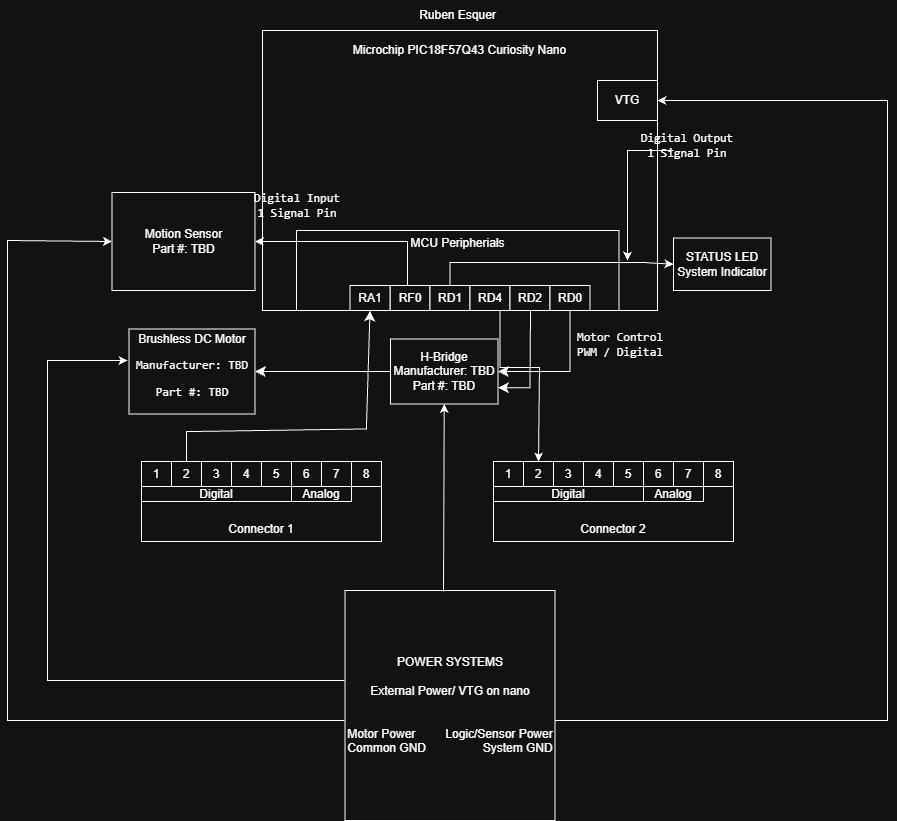

## Overview

This block diagram shows the electrical and control layout for my subsystem of the automated garment folding device. The system uses a Microchip PIC18F57Q43 Curiosity Nano to interface with the motion sensor, status LED, motor driver, motor, power system, and team connectors.

## Block Diagram

