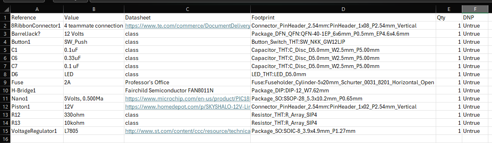

---
title: Bill of Materials
---

# Bill of Materials

## Overview

This Bill of Materials (BOM) documents the electrical, electromechanical, and mechanical components required for the automated garment-folding subsystem. It establishes the component inventory, design requirements, and estimated procurement costs for prototype development and system integration.

The subsystem incorporates a Microchip PIC18F57Q43 Curiosity Nano microcontroller, a 12V linear actuator, an H-bridge motor driver, voltage regulation, circuit protection, and electrical connectors. Additional mechanical components include 3D-printed supports and hinges for the folding mechanism.

The BOM was developed from the KiCad schematic and component selection process.

## Bill of Materials

The following figure presents the completed Bill of Materials, including component descriptions, quantities, pricing, and purchasing information recorded in the Excel spreadsheet.

{style="width:100%; max-width:1200px;"}

*Figure 1: Bill of Materials for the automated garment-folding subsystem.*

## Component Selection and Design Decisions

### Microcontroller

The Microchip PIC18F57Q43 Curiosity Nano serves as the subsystem controller. It provides digital input/output functionality for actuator control, user inputs, status indication, and communication with other team subsystems.

The development board was selected for compatibility with MPLAB X IDE, MCC Melody, and the team's embedded development environment.

### Motor Driver and Linear Actuator

The folding mechanism uses a SKYSHALO 12V linear actuator with a nominal 6-inch stroke. The actuator provides the mechanical force required to extend and retract the folding panel.

The FAN8011N H-bridge is identified in the schematic for bidirectional motor control. Its suitability for the actuator must be confirmed against operating current, stall current, and driver output ratings before hardware implementation.

### Mechanical Components

The subsystem incorporates 3D-printed structural components and folding-panel hinges.

PLA or PETG filament supports fabrication of custom mounting brackets, actuator supports, and structural attachments. Hinges allow the folding panel to rotate relative to the stationary platform.

These components provide mechanical flexibility and allow modifications during prototype testing.

### Power Regulation and Protection

The subsystem uses a 12V DC supply for actuator operation and an L7805 regulator for the 5V control circuitry.

Input protection is provided by a fuse. The final fuse rating must be coordinated with actuator current requirements, conductor ratings, and expected startup conditions.

### User Input and Status Indication

A momentary pushbutton provides a digital control input, while an LED indicates subsystem status.

The circuit incorporates current-limiting and pull-up resistors along with capacitors for regulation stability and input signal conditioning.

### Connectors and System Integration

The subsystem includes 8-pin, 4-pin, and 2-pin electrical connectors for interfacing with external components and other team subsystems.

Connector selection considers pin count, physical compatibility, current capacity, and ease of assembly. Matching connector interfaces are required for reliable integration.

## Cost Analysis

The component prices and quantities documented in Figure 1 provide the basis for estimating subsystem procurement costs.

The BOM includes electronic components, actuator hardware, connectors, and mechanical fabrication materials. Components already available through laboratory inventory may reduce the actual purchasing cost.

Additional quantities should be considered for breadboard prototyping, PCB assembly, and replacement parts. The final purchase request will distinguish existing inventory from components requiring procurement.

## Relationship to Product Requirements

The selected components support controlled folding-panel movement, subsystem integration, and prototype reliability.

The linear actuator and hinges provide the mechanical folding action, while the microcontroller and motor driver coordinate electrical control. The modular connectors support integration with other team subsystems.

The design prioritizes functional performance, affordability, maintainability, and ease of prototype modification.

## Conclusions

The Bill of Materials establishes the component requirements for manufacturing, assembling, and testing the automated garment-folding subsystem.

The completed spreadsheet provides a reference for component selection, purchasing decisions, and cost tracking. Final hardware verification will focus on actuator-driver compatibility, power protection, connector interfaces, and mechanical assembly requirements.

## Resources

- [Microchip PIC18F57Q43 Curiosity Nano Evaluation Kit](https://www.microchip.com/en-us/development-tool/DM164150)
- [PIC18F57Q43 Curiosity Nano Hardware User Guide](https://ww1.microchip.com/downloads/aemDocuments/documents/MCU08/ProductDocuments/UserGuides/PIC18F57Q43-Curiosity-Nano-HW-UserGuide-DS40002186B.pdf)
- [STMicroelectronics L7805 Voltage Regulator](https://www.st.com/en/power-management/l78.html)
- [SKYSHALO Linear Actuator Product Reference](https://www.homedepot.com/p/334440429)
- [EGR 304 Component Sourcing Resources](https://embedded-systems-design.github.io/sources-for-electrical-and-electromechanical-components/)

## Notes

This BOM represents the current prototype configuration. Component specifications, purchasing quantities, and costs are subject to updates following hardware testing and procurement review.

Mechanical components such as filament and hinges are included in the BOM even though they are not represented as electrical symbols in the KiCad schematic.
