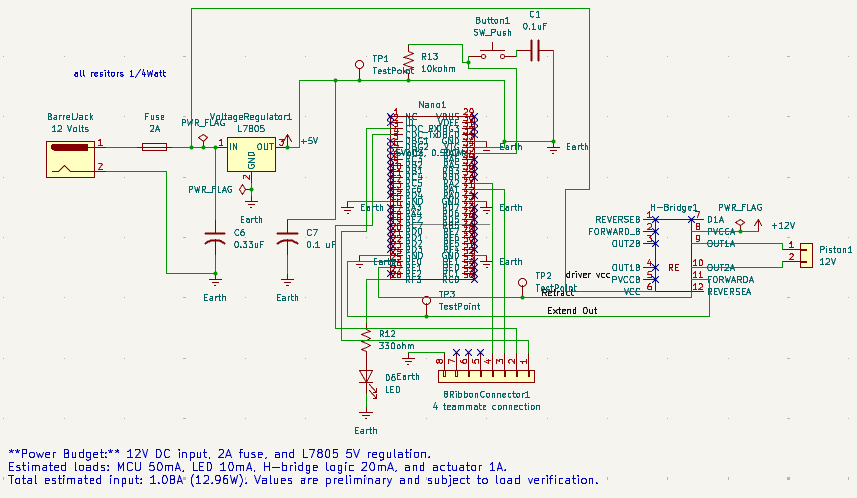

---
title: Schematic
---

## Overview

This schematic illustrates the electrical design of the linear actuator control subsystem for our automated garment-folding machine. The subsystem uses a Microchip PIC18F57Q43 Curiosity Nano microcontroller to control a 12 V linear actuator through a Fairchild Semiconductor FAN8011N H-bridge motor driver.

The linear actuator is responsible for moving one of the folding panels. The H-bridge allows the microcontroller to control the actuator's direction of movement, enabling the panel to extend and retract during the folding sequence.

## Circuit Design and Functionality

### Microcontroller and Motor Control

The PIC18F57Q43 Curiosity Nano serves as the subsystem controller. Digital control signals are sent to the FAN8011N H-bridge, which switches the motor output polarity to extend or retract the linear actuator.

The H-bridge separates the low-power microcontroller control signals from the higher-power actuator circuit.

### Power Supply

The circuit includes a DC barrel jack, fuse, and L7805 voltage regulator. The regulator provides a regulated 5 V supply for the appropriate low-voltage components, while the actuator requires a 12 V power source.

The fuse provides protection against excessive current. The motor driver and power supply must be appropriately rated for the actuator's operating and stall currents.

### User Input and Status Indicator

A pushbutton provides a digital input to the microcontroller through RA7. The button circuit includes a 10 kΩ resistor and a 0.1 µF capacitor to establish a stable input and reduce unwanted switching noise.

A status LED with a 330 Ω current-limiting resistor provides visual feedback during subsystem operation.

### Electrical Connections

The schematic includes an eight-pin connector for communication and interfacing with other subsystems, a four-pin connector, and a two-pin connector for the linear actuator.

These connections allow the subsystem to be integrated into the complete automated folding machine.

## Product Requirements

This subsystem supports the product requirements by providing controlled folding-panel movement, a user-operated input, and an electrical interface for communication with the other subsystems.

The linear actuator provides the mechanical motion required to fold garments, while the microcontroller coordinates actuator operation as part of the overall folding sequence.

## Schematic Diagram

**Figure 1:** Electrical schematic of the linear actuator control subsystem.

## Resources

- [High-Resolution Schematic PDF](EGR304_Subsystem_Schematic.pdf)
- [KiCad Schematic Project ZIP](EGR304_Subsystem_Schematic.zip)
