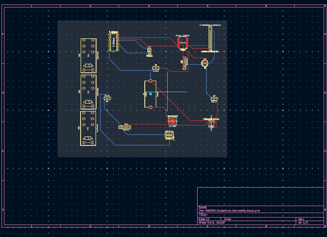

---
title: PCB Design
---

# PCB Design

## Overview

This section documents the printed circuit board (PCB) design for my individual subsystem of the automated laundry folding device. The PCB was designed using KiCad and includes the electrical connections and components required for subsystem operation.

## PCB Layout

The PCB was designed using two copper layers for component connections and signal routing.

### PCB Design

[Download PCB Layout PDF](PCB_Final.pdf)

## Design Rules Check (DRC)

The PCB design was verified using KiCad's Design Rules Checker. The final check reported zero errors and zero unconnected items, with three silkscreen clearance warnings.

[View DRC Confirmation](DRC_Confirmation.pdf)

## ECAD Project Files

The complete KiCad project files are available below.

[Download ECAD Project](ECAD_Project.zip)

## Gerber Manufacturing Files

The Gerber and drill files required for PCB manufacturing are included in the following archive.

[Download Gerber Files](gerber_files.zip.zip)

## Manufacturing Pre-Check

The Gerber files were uploaded to JLCDFM for manufacturing verification. The DFM operation did not complete successfully, so a validated analysis report is not yet available.
